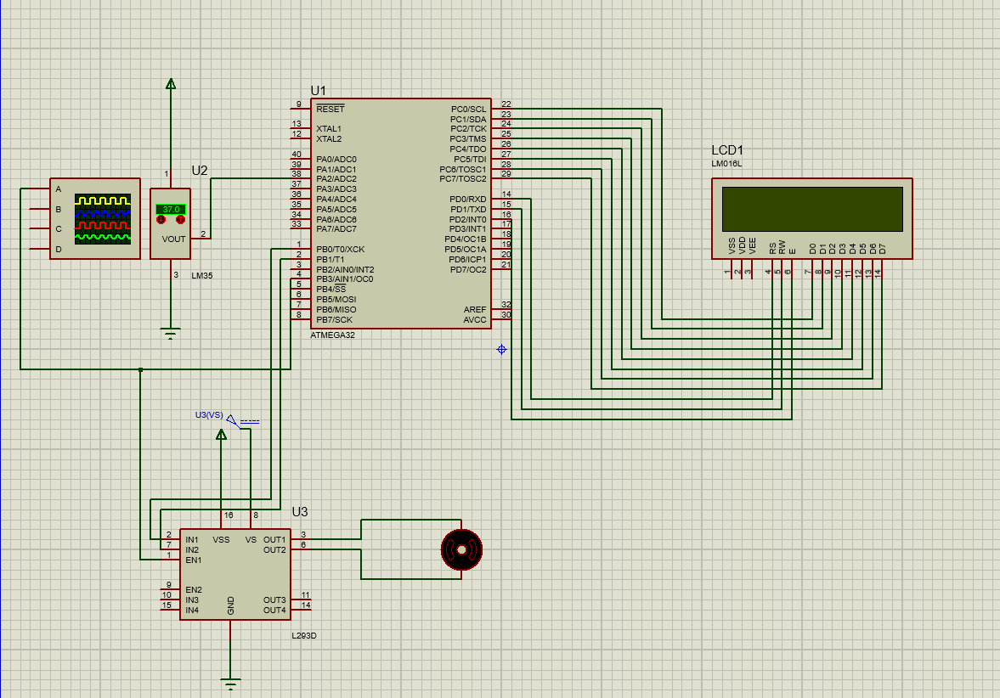

<h1 align="center">Temperature-Controlled Fan System</h1>

<p align="center">
An embedded system that regulates the speed of a DC fan automatically, based on the ambient temperature measured by an LM35 sensor.
</p>

<p align="center">
  
  
  
  
</p>

---

## Table of Contents

1. [Abstract](#1-abstract)
2. [System Requirements](#2-system-requirements)
3. [System Architecture](#3-system-architecture)
4. [Principle of Operation](#4-principle-of-operation)
5. [Hardware Description](#5-hardware-description)
6. [Driver Specification](#6-driver-specification)
7. [Temperature Calculation](#7-temperature-calculation)
8. [Simulation](#8-simulation)
9. [Repository Structure](#9-repository-structure)
10. [Build and Run Instructions](#10-build-and-run-instructions)
11. [Tools and Technologies](#11-tools-and-technologies)
12. [Author](#12-author)

---

## 1. Abstract

This project implements a temperature-controlled fan system on an ATmega32 microcontroller. An LM35 analog temperature sensor is sampled through the on-chip ADC, the reading is converted to degrees Celsius, and the fan speed is adjusted through a PWM signal that drives a DC motor. The current fan state and temperature are shown continuously on an LCD.

The software follows a layered architecture (Application, Hardware Abstraction Layer, Microcontroller Abstraction Layer), which separates application logic from hardware-specific code and makes each driver reusable.

---

## 2. System Requirements

| # | Requirement |
|---|-------------|
| 1 | Microcontroller: ATmega32 |
| 2 | Measure the ambient temperature with an LM35 sensor through the ADC |
| 3 | Configure the ADC through a configuration structure (reference voltage and prescaler) |
| 4 | Control the DC motor speed using PWM generated by Timer0 |
| 5 | Display the fan state and the current temperature on an LCD |
| 6 | Implement the project using the layered architecture model |

---

## 3. System Architecture

```
+--------------------------------------------------+
|              Application Layer                   |
|        Fan control logic  (project.c)            |
+--------------------------------------------------+
|        Hardware Abstraction Layer (HAL)          |
|        LCD  |  LM35 Sensor  |  DC Motor          |
+--------------------------------------------------+
|     Microcontroller Abstraction Layer (MCAL)     |
|         GPIO  |  ADC  |  PWM (Timer0)            |
+--------------------------------------------------+
```

| Layer | Responsibility |
|-------|----------------|
| **Application** | Reads the temperature, selects the fan speed, and updates the display |
| **HAL** | Provides device-level interfaces independent of the MCU registers |
| **MCAL** | Provides direct access to the ATmega32 peripherals |

---

## 4. Principle of Operation

1. The ADC samples the LM35 output continuously (polling mode).
2. The raw ADC value is converted to a temperature in degrees Celsius.
3. The application selects the fan speed according to the temperature range below.
4. The PWM duty cycle is updated to match the selected speed.
5. The LCD is refreshed with the fan state and the temperature.

### Speed Control Logic

| Temperature Range | Fan State | Direction | Speed (PWM Duty Cycle) |
|-------------------|-----------|-----------|------------------------|
| T < 30 °C | OFF | Stopped | 0% |
| 30 °C ≤ T < 60 °C | ON | Clockwise | 25% |
| 60 °C ≤ T < 90 °C | ON | Clockwise | 50% |
| 90 °C ≤ T < 120 °C | ON | Clockwise | 75% |
| T ≥ 120 °C | ON | Clockwise | 100% |

### LCD Output

```
     FAN is ON
     Temp =  45 C
```

---

## 5. Hardware Description

| Component | Description | Interface |
|-----------|-------------|-----------|
| ATmega32 | Main controller | n/a |
| LM35 | Analog temperature sensor, 10 mV/°C, range 0 to 150 °C | ADC channel 2 (PA2) |
| DC Motor | Fan actuator, driven through an H-bridge | Direction: PB0, PB1. PWM: OC0 (PB3) |
| 2x16 LCD | Displays fan state and temperature | GPIO |

---

## 6. Driver Specification

| Driver | Layer | Description |
|--------|-------|-------------|
| **GPIO** | MCAL | Configures pin directions and reads/writes pin and port values |
| **ADC** | MCAL | Polling-based driver configured through `ADC_ConfigType` (internal 2.56 V reference, prescaler of 8); returns the 10-bit conversion result of a selected channel |
| **PWM** | MCAL | Generates a PWM signal using Timer0 to control the motor speed |
| **LCD** | HAL | Initializes the display and prints characters, strings, and integers |
| **LM35** | HAL | Converts the ADC reading of the sensor to a temperature value |
| **DC Motor** | HAL | Controls direction through PB0/PB1 (`stop`, `clock_wise`, `anti_clock_wise`) and speed through Timer0 PWM |

---

## 7. Temperature Calculation

The LM35 outputs 10 mV per degree Celsius. The ADC uses the internal 2.56 V reference with 10-bit resolution, and the sensor is scaled for a range of 0 to 150 °C, which corresponds to a maximum output of 1.5 V.

| Parameter | Value |
|-----------|-------|
| `ADC_REF_VOLT` | 2.56 V |
| `ADC_MAXIMUM_VALUE` | 1023 |
| `SENSOR_MAX_VOLT_VALUE` | 1.5 V |
| `SENSOR_MAX_TEMPERATURE` | 150 °C |
| `SENSOR_CHANNEL_ID` | 2 |

The temperature is computed in `LM35_GetTemperature()` as:

```
Temperature (°C) = ( ADC_value × 150 × 2.56 ) / ( 1023 × 1.5 )
```

At the maximum sensor output of 1.5 V, the ADC value is approximately 600, which gives 150 °C. The result is returned as an 8-bit integer.

---

## 8. Simulation

The system was designed and tested in Proteus. The project file is `Fan_Controller.pdsprj`.



---

## 9. Repository Structure

```
Fan-Controller-ATmega32/
├── Fan_Controller/
│   ├── project.c            # Application layer
│   ├── adc.c / adc.h        # MCAL: ADC driver
│   ├── pwm.c / pwm.h        # MCAL: Timer0 PWM driver
│   ├── gpio.c / gpio.h      # MCAL: GPIO driver
│   ├── lcd.c / lcd.h        # HAL: LCD driver
│   ├── lm.c / lm.h          # HAL: LM35 temperature sensor driver
│   ├── dc_motor.c / .h      # HAL: DC motor driver
│   ├── common_macros.h      # Common bit-manipulation macros
│   └── std_types.h          # Standard data types
├── docs/
│   └── simulation.png       # Proteus simulation screenshot
├── Fan_Controller.pdsprj    # Proteus project file
└── README.md
```

---

## 10. Build and Run Instructions

1. Open the `Fan_Controller` folder as an AVR C project in Eclipse (AVR toolchain).
2. Build the project to generate the `.hex` file.
3. Open `Fan_Controller.pdsprj` in Proteus.
4. Double-click the ATmega32, set the program file to the generated `.hex`, and set the clock frequency to match the value used in the project.
5. Run the simulation and vary the temperature on the LM35 to observe the fan response.

---

## 11. Tools and Technologies

- **Microcontroller:** ATmega32
- **Language:** Embedded C
- **IDE:** Eclipse with the AVR toolchain
- **Simulation:** Proteus
- **Concepts:** layered architecture, ADC, PWM, GPIO, LCD interfacing, sensor signal conversion

---
